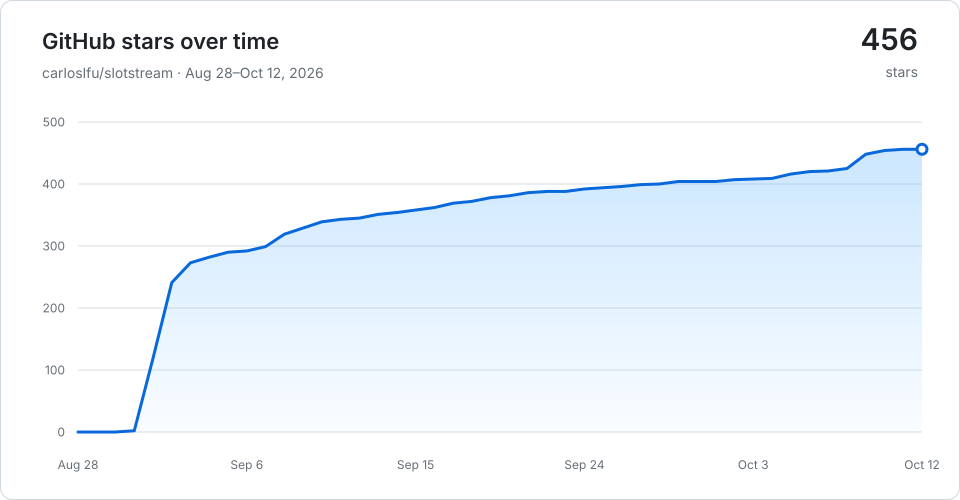

# slotstream

[](https://github.com/carloslfu/slotstream/releases/latest)
[](#star-history)

**Run a 105 GB AI model on a Mac that can't hold it.**

Slotstream is a fully native local AI engine for Apple Silicon Macs, written
in Swift on Apple's MLX and Metal. It streams model experts from SSD and keeps
the ones it needs in a memory cache, so the model can be much larger than your
Mac's RAM. Inference runs on your Mac, offline after the download, with no
Python runtime or cloud account.

The released engine runs [Qwen3.8-Flash-Next](https://huggingface.co/pipenetwork/Qwen3.8-Flash-Next-MLX-4bit),
a 125-billion-parameter open model, on Macs with 16 to 64 GB of memory.
Our 48 GB M5 Pro measured **20.91–23.69 tok/s** across three workloads in
development tests at a 33 GB memory budget, using the original 4-bit model
([results and test conditions](#speed)). This repository also contains a
native Mac app and additional model choices in development.

[Get started](#install) · [Mac app](#native-mac-app) · [Models](#fast-and-smart) · [Speed](#speed) · [Get help](#support)

## Available now

The [latest release, v0.2.30](https://github.com/carloslfu/slotstream/releases/tag/v0.2.30),
ships the engine and command-line tool. Its default is the original
Qwen3.8-Flash-Next 4-bit model. The installer below downloads this release.

Chat with it, ask it about pictures, or code with it: `slotstream launch claude`
starts Claude Code on the local model, and Codex, Pi, opencode and Hermes work
the same way. Developers can connect their own apps through its Ollama-,
OpenAI- and Anthropic-compatible APIs or its Swift library.

## In development

The following work is available in source on `main`. The v0.2.30 engine
download does not include it, and there is no published Mac app installer yet.

### Fast and Smart

Development builds let you choose a model for the work at hand:

| Choice | Model | Intended use |
|---|---|---|
| **Fast** | Qwen3.6-35B-A3B, MLX 4-bit | Everyday questions, writing, summaries and tools |
| **Smart** | Qwen3.8-Flash-Next, original MLX 4-bit | More demanding reasoning |

Fast is the default for a new **Mac app** installation. Existing app settings
keep their model, and the **CLI still defaults to the original model**, now
called Smart. Both use the native engine, streaming experts when they do not
fit in memory. Fast can keep all its experts resident when there is room.

See [choosing a model](docs/MODELS.md) for the `fast` and `smart` commands,
setup and limitations. The smaller [Smart Q2 candidate](docs/ENGINEERING.md#native-compressed-smart-candidate)
is an explicit experiment; it has not replaced Smart or entered normal setup.

### Native Mac app

The app runs the engine directly in a SwiftUI and AppKit interface. You can
work with local documents, ask questions with citations, draft and review
file changes, analyze CSV tables, and keep conversations, memories and a
journal on your Mac. A Home holds that work in local files; separate Homes
keep separate data.

The Data browser lets you inspect saved records and their relationships.
The bundled `slotstream-home` command, agent skill and local MCP server give
other tools access to the same Home. Proposed changes still go through the
app's review controls.

This is a development app. Its [guide](docs/SLOTSTREAM-MAC.md) explains how to
build it and what each workflow supports today. See [Homes and integrations](docs/SLOTSTREAM-HOMES.md)
for data access and agent connections.

## Who it's for

Slotstream focuses on Macs with **16 to 64 GB** of memory, where running the
larger model depends on managing what stays in RAM and what comes from SSD.
The CLI and APIs suit people using local chat apps or coding agents; the Mac
app in development brings the engine to document work and personal knowledge.

The original model also runs on 96 GB and larger Macs, but those are outside
the optimization target: engines that keep it fully resident report faster
replies there. See
[related projects](docs/ENGINEERING.md#related-projects) if that is your Mac.

## Will it run on my Mac?

For the released engine and its default model, you need an **Apple Silicon
Mac with at least 16 GB of memory, macOS 14 or later, and about 110 GB of free
SSD space**. Open About This Mac from the
Apple menu to check your chip and memory. On an 8 GB Mac even the smallest
memory plan doesn't fit, so Slotstream refuses to start instead of swapping.
Windows, Linux and Intel Macs are not supported. The
[hardware guide](docs/HARDWARE.md#what-you-need) has the tested macOS versions.

## Speed

These measurements and planning ranges describe the **original
Qwen3.8-Flash-Next 4-bit model**, called Smart in development builds. They are
not benchmarks of Fast or the Q2 candidate. Every published result links to
its method; unsuccessful experiments stay in the [measurements](MEASUREMENTS.md).

`tok/s` means tokens per second; a token is a small piece of text, often part
of a word. These speeds describe reply generation; loading the model and
processing the prompt take additional time.

**On October 5, 2026, our 48 GB M5 Pro measured 20.91–23.69 tok/s with the
original 4-bit model at a 33 GB memory budget.** The development build used the Slotstream
Desktop startup settings and its existing automatic memory ceiling:

| Workload | Median generation speed |
|---|---:|
| Short prompt | 20.91 tok/s |
| Longer context | 23.69 tok/s |
| Completed coding answer | 21.59 tok/s |

Each workload ran three times without swapping during the measured runs.
The first two used fixed-length replies; the coding task ran to completion.
These are short controlled tests with an uncontrolled filesystem cache,
not a sustained-session guarantee or a measurement of other Macs. The
[hardware guide](docs/HARDWARE.md#october-5-development-tests) gives the
build, configuration and recorded evidence.

The larger budget keeps more experts in RAM, reducing weight reads during
generation. No new quantization was needed for these results. They do not
establish a speedup over an older release at identical settings.

The earlier **0.2.19 release benchmark measured 15.86 tok/s at a 22 GB memory
target**, on eight prompts the engine was never tuned on. The engine predicts
which experts the next layers will need and reads them from the SSD before they are asked for,
which changes speed and never the output. The
[expert lookahead guide](docs/EXPERT-LOOKAHEAD.md) has the measurements behind
each release. This historical test used smaller prompt passes and disabled
prefix caching, leaving more memory for experts. It is not a measurement of
today's automatic configuration. The
[0.2.23 calibration attempt](db/records/measurements/release-speed-calibration-2026-09-22.md)
did not qualify a replacement release benchmark; the newer development tests
above use a different budget, workload set and method.

<a id="speed-by-memory"></a>
<a id="speed-by-mac-memory"></a>

### What to expect by memory

Rough planning ranges for warm replies, from community reports and our own
measurements, rounded outward. Faster chips and SSDs sit at the top of each
range; other apps and memory pressure pull results down.

| Installed RAM | Estimated warm reply speed | Example automatic context window |
|---|---|---|
| 8 GB | Unsupported by the current memory plan | Not available |
| 16–<24 GB | ~1–6 tok/s | 32,768 tokens |
| 24–<48 GB | ~5–16 tok/s | 32,768 through 32 GB; 65,536 at 36 GB |
| 48–<96 GB | ~15–27 tok/s | 32,768 at 48 GB; 131,072 at 64 GB |
| 96 GB+, the model fits in memory | ~20–32 tok/s | 262,144 tokens, the model's full window |

Context examples use decimal-GB memory simulations. A Mac's marketed capacity,
Metal limits and available memory can produce a different plan; `slotstream
doctor` shows the actual choice.

The middle rows are anchored on our M5 Pro's measurement; the top ends of the
last two rows come from a 128 GB M5 Max with a larger, manually chosen memory
target, and the last row is outside Slotstream's target range. These are
estimates, not limits. The hardware guide has the
[basis of each range](docs/HARDWARE.md#planning-ranges), every result
[measured on real Macs](docs/HARDWARE.md#results) with credits and test
conditions, and [every automatic memory plan](docs/HARDWARE.md#automatic-memory-plans).

### Recent prompt-processing results

The changes shipped in 0.2.23 shorten prompt processing and repeated-history
work. These measurements use the same 48 GB M5 Pro at a 10 GB target, with
three clean pairs per comparison:

| Workload | Matched control | Median times, control → enabled | Median paired time reduction |
|---|---|---|---|
| 16K inventory prompt, MTP on | Larger-read workspace policy off | 155.22 s → 53.94 s prefill | 65.40% |
| 2K prose follow-up, MTP off | Prefix checkpoints disabled | 30.73 s → 4.42 s request | 85.62% |

Both comparisons switch a feature off in the same tested binary. They measure
prompt processing or a cached follow-up, not an increase in reply tok/s or a
whole-release speedup. Times are arm medians; reductions are medians of paired
changes. The [hardware guide](docs/HARDWARE.md#recent-prompt-processing-results)
explains the fixtures and the latest audit's exclusions.

A fresh installed-release study used ordinary caching at the same memory
target. These are observed first-read ranges and median exact-repeat request
times across the prescribed request order, with capped replies:

| Prompt | Eligible first reads / repeats | First-read prefill range | Median repeated request |
|---|---:|---:|---:|
| 2K code | 4 / 3 | 13.86–28.11 s | 2.79 s |
| 2K prose | 3 / 3 | 14.91–26.51 s | 3.22 s |

The desktop load screen passed for the included observations, but several
runs had system swap-ins. Request history changed read batching, so these
results do not replace the general speed estimates or decode headline.
See the [measurement and its limits](db/records/measurements/release-prefill-2k-2026-09-22.md).

<a id="memory"></a>
<a id="context"></a>

### Memory and context

For the original model, **Auto mode picks the memory target, cache size,
speculative decoding and context window for your Mac.** It takes the largest window in the table above
that still leaves room for speculative decoding and a complete conversation,
given the memory free at startup, without an unmeasured loss of useful
expert cache. `slotstream doctor` shows the choice and
why, and `--max-context 65536` sets a window yourself, up to 262,144 tokens.

**Starting a reply takes time.** Slotstream first reads your question and the
conversation history, which can take minutes for a long prompt. Follow-up
turns reuse unchanged history, a new conversation reuses the system prompt
earlier ones started with, and `serve --prefix-cache-dir` keeps long
conversations and shared system prompts on disk so that they survive a
restart. The hardware guide
has the [prompt-reading estimates](docs/HARDWARE.md#automatic-memory-plans)
for each memory size.

## Install

To install the released engine, open Terminal and paste this command:

```sh
curl -fsSL https://raw.githubusercontent.com/carloslfu/slotstream/main/install.sh | sh
```

Run the same command to update. If `slotstream` isn't found afterward, open
a new terminal window.

## Use it

Check your Mac, then ask for a first reply:

```sh
slotstream doctor
slotstream run --prompt "Why is the sky blue?"
```

<a id="downloading-the-model"></a>

`doctor` checks memory and disk space without loading the model. The first
`run` asks to download it, then prints a reply. This download can take hours,
but you only need to do it once. Interrupted downloads resume when you try
again. Follow the [step-by-step setup](docs/GETTING-STARTED.md) for more help.

<a id="chat-apps-and-the-api"></a>
<a id="pictures"></a>
<a id="coding-agents"></a>
<a id="docs"></a>

## Guides

| What would you like to do? | Guide |
|---|---|
| Build the native Mac app in development | [Slotstream for Mac](docs/SLOTSTREAM-MAC.md) |
| Choose Fast or Smart in a development build | [Models](docs/MODELS.md) |
| Inspect a Home or connect an agent to the app | [Homes and integrations](docs/SLOTSTREAM-HOMES.md) |
| Chat in Open WebUI or another app | [Connect a chat app](docs/CLIENTS.md) |
| Ask about a picture | [Use an image](docs/GETTING-STARTED.md#ask-about-a-picture) |
| Start a coding agent on the model, in one command | [Use coding agents](docs/CODING-AGENTS.md) |
| Code with Claude Code | [Use Claude Code](docs/CLAUDE-CODE.md) |
| Code with Codex | [Use Codex](docs/CODEX.md) |
| Code with Pi or opencode | [Use Pi or opencode](docs/CODING-AGENTS.md#pi) |
| Work with files and tools through Hermes | [Use Hermes](docs/HERMES.md) |
| Code with fx, Vercel Labs' coding agent | [Use fx](docs/FX.md) |
| Fix a problem, move the model, or uninstall | [Troubleshooting](docs/TROUBLESHOOTING.md) |

Install chat apps and agents separately. They provide the interface and tools;
Slotstream runs the model. Keep its server running while a connected app uses it.
`slotstream launch claude` (or `codex`, `pi`, `opencode`, `hermes`) starts
that agent already connected, and starts the server in the background first
when none is running.

<a id="use-it-from-swift"></a>
<a id="testing"></a>
<a id="building-and-testing"></a>

For developers, the [engineering guide](docs/ENGINEERING.md) links to the
OpenAI- and Ollama-compatible API references, Swift library, command options,
build instructions, and tests. [Release notes](CHANGELOG.md) show what changed.

## How it works

The maintained models use a *mixture-of-experts* architecture: generating each
piece of text uses only a subset of their expert networks. Slotstream keeps shared
weights in memory and reads the needed experts from SSD into a cache.
Frequently used experts stay in RAM, reducing repeated disk reads.

The whole model stays available even when it doesn't all fit in memory.
Slotstream chooses a memory target for your Mac and adjusts its cache as
other apps need room. Cache size changes speed without removing experts
from the model. The [engineering explanation](docs/ENGINEERING.md#how-it-works)
covers the implementation.

<a id="built-native"></a>

## Built native

Slotstream is fully native. Swift owns the command-line tool, HTTP server,
model, memory planner, expert cache and request lifecycle. Apple's MLX and
Slotstream's own Metal kernels execute the tensor operations on the GPU.
Development builds also use C++ adapters for prepared Metal execution on
the same MLX stream. No Python runtime or interpreter sits between a request
and the GPU. The Mac app uses SwiftUI and AppKit and calls the engine in process.

That is deliberate. Built around a small maintained set of models on Apple
Silicon, each layer is tuned for the one below it: experts are read from SSD
into a bounded cache, the memory plan is checked against
what the process really uses, and a governor resizes the cache while other apps
need room. The engine installs with one command and exposes the same native
runtime through its CLI, serving APIs and Swift library. The speed on
this page comes from measured mechanisms that this control allows, not from
the language itself; every published number has a recorded method in the
[measurements](MEASUREMENTS.md). The trade is that the engine runs only on
Apple Silicon. Windows and Linux are not supported.

## Status and limits

- **The larger model is not optimized for 96 GB and larger Macs**;
  see [Who it's for](#who-its-for).
- **One generation at a time:** connected apps share the same running model.
- **Model choice is explicit:** development builds load one selected model.
  Fast supports text and tools; direct engine image understanding uses Smart.
  The development app extracts text from images with OCR.
- **Conversation length is limited:** longer histories take more memory and
  time. Auto mode picks a [window for each memory size](#speed-by-memory), and
  the coding agent guides include the larger window agents need.
- **No broad benchmarks yet:** image input and tool calling have integration
  tests, but there is no image-accuracy benchmark or completed comparison with
  other models on the same Mac.

## FAQ

### Does it work offline?

Yes, after downloading the model. Inference runs on your Mac. Connected
agents may still use internet services for web searches or other tools;
their settings determine what those tools send.

### Why doesn't Slotstream use all of my RAM?

`--memory-gb 48` is a maximum process budget, not a promise to keep 48 GB
resident. Slotstream allocates the expert cache at load, while conversation
state and temporary work grow only when a request needs them. A short request
can therefore peak well below the target. The startup report shows the budget,
expert cache, runtime allowances and safety headroom separately.

For the released CLI's original model, Auto uses a **33 GB** base ceiling,
or **34.6 GB** with speculative decoding at the 32,768-token window. This measured default
leaves memory for other apps. To use more, stop any running server and preview
the plan without loading the model:

```sh
slotstream doctor --memory-gb 40
```

If it fits with headroom, `slotstream serve --memory-gb 40` uses that budget
with a fixed cache. Use `--memory-limit-gb` instead to choose an upper limit while the cache adapts
to other apps. Custom limits can exceed the automatic default; the Mac's
supported budget and available memory still bound actual use.
Auto keeps expert cache when a larger automatic context would trade it away
without a measured benefit. Use `--max-context N` when you explicitly want a
longer window. Leave room for macOS and other apps. See the
[memory options](docs/CLI.md#memory-options) for details.

### Is Slotstream the fastest way to run this model?

Slotstream is built to make the larger model useful on a Mac that cannot
hold it in memory. Speed depends on the model, memory budget, SSD and workload;
the measurements above describe the cases tested. On 96 GB and larger Macs,
engines that keep the original model resident report faster replies.
See [Who it's for](#who-its-for) and
[related projects](docs/ENGINEERING.md#related-projects).

### Why is it written in Swift and not Python?

Swift lets the engine own memory, disk reads and the model lifecycle while
fitting directly into a native Mac app. MLX and Metal provide the GPU work,
without a Python runtime to install or a separate inference process for the app.
The Python in this repository is development tooling: reference implementations,
benchmark drivers and release checks. None of it runs on the engine's inference
path. See [Built native](#built-native).

### Will this wear out my SSD?

Generation reads the model files without rewriting them. macOS swap adds
writes when memory runs short. Automatic memory sizing helps, but a small
Mac or an oversized manual setting can still swap heavily. Servers that
`slotstream launch` starts, and `serve --prefix-cache-dir`, also save each
turn of a longer conversation to a cache folder, and the system prompts
conversations share, within a disk quota.

### Can I run it on Linux or Windows?

No. The current engine requires Apple Silicon, MLX and Metal.

<a id="related-projects"></a>

### Can I use a different model?

The released engine runs Qwen3.8-Flash-Next. Development builds also support
Qwen3.6-35B-A3B through the [Fast and Smart choices](docs/MODELS.md).
Slotstream maintains specific models and their execution paths; it does not
load arbitrary checkpoints. See [related projects](docs/ENGINEERING.md#related-projects)
for runtimes with broader model and hardware support.

## Why this exists

I wanted to run this model on my own Mac, but the standard loader exhausted
memory before producing a reply. Slotstream grew out of that experiment.
The [published measurements](MEASUREMENTS.md#m07--the-naive-path-fails-why-slotstream-exists)
include that failed load and the experiments that followed.

The project was also [discussed on Hacker News](https://news.ycombinator.com/item?id=49524447).
The questions and hardware reports from that discussion help guide the work.

## Support

[Report a bug](https://github.com/carloslfu/slotstream/issues/new) if something
doesn't work, or [share your Mac's results](docs/HARDWARE.md#how-to-measure)
to help others know what to expect. Reports are credited to their authors.
Code and documentation contributions are welcome; see
[Contributing](CONTRIBUTING.md) for the workflow.

## Grants and sponsors

<p>
  <a href="https://github.com/rauchg">
    <br>
    <strong>Guillermo Rauch</strong>
  </a>
</p>

Slotstream was selected for [Guillermo Rauch's personal grants for foundational
open-source software](https://rauchg-oss-grants.vercel.app/).
Thank you for supporting its development.

## Who made this

I'm [Carlos Galarza](https://www.carlosgalarza.com). I build local AI and
make it run efficiently on the computers people already own. Slotstream is
written natively for the Mac and tuned as one system. The
[Slotstream Mac app](docs/SLOTSTREAM-MAC.md) is under development in this repository.
I also help teams run open models on their own hardware and debug agent
workflows. For help or consulting, [email me](mailto:carloslfu@gmail.com).

## Star history

<picture>
  <source media="(prefers-color-scheme: dark)" srcset="docs/assets/star-history-dark.svg">
  
</picture>

The badge at the top shows the latest star count; this chart is updated weekly.

## License

Slotstream is [MIT-licensed](LICENSE). Model weights and included third-party
code retain their own licenses. The released model uses the
[Qwen community license](https://huggingface.co/pipenetwork/Qwen3.8-Flash-Next-MLX-4bit/blob/main/LICENSE);
see [third-party notices](THIRD_PARTY_NOTICES.md) for the other components.
See [credits](docs/ENGINEERING.md#credits) for the model and code this project builds on.
